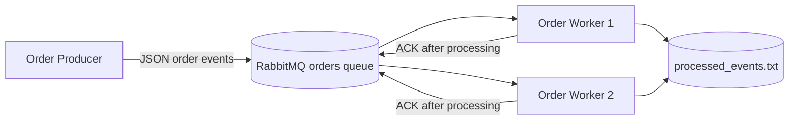
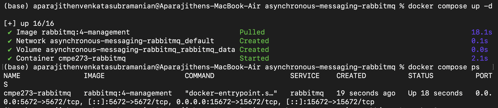
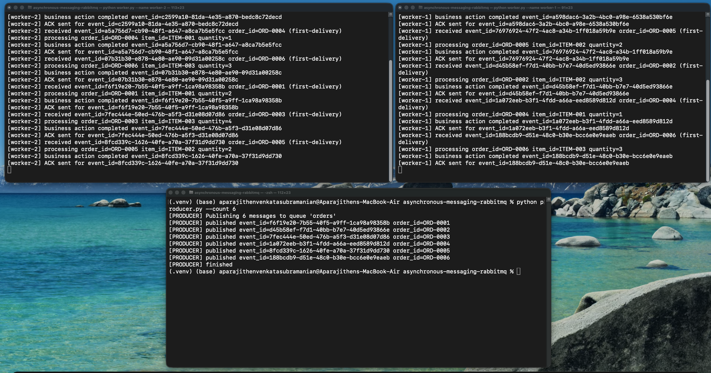
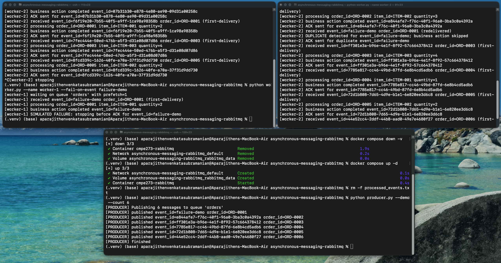
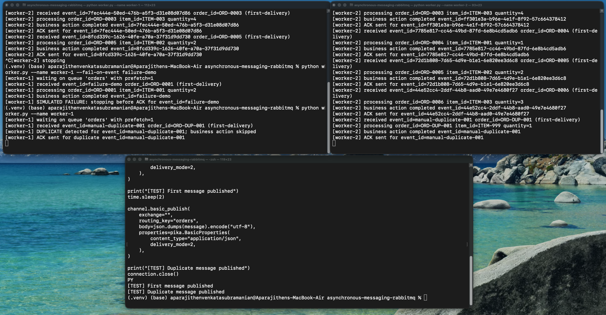

# CMPE 273 Module 5: Asynchronous Messaging with RabbitMQ

## Overview

This project implements a simple asynchronous order-processing system using RabbitMQ.

The system has:

- An Order Producer that publishes order messages.
- Two Order Workers that consume and process messages.
- Manual acknowledgements after processing.
- Competing consumers using the same queue.
- Failure and message redelivery handling.
- Duplicate-event detection using `event_id`.

## Architecture



Both workers consume from the same `orders` queue. RabbitMQ distributes messages between the workers. Each worker uses `prefetch_count=1`, so it receives one unacknowledged message at a time.

The workers use manual acknowledgements. A message is acknowledged only after the business action is completed.

If a worker stops before sending an ACK, RabbitMQ makes the message available again. Another worker can then receive the redelivered message.

## Message Format

Each order message contains the following fields:

```json
{
  "event_id": "unique-event-id",
  "order_id": "ORD-0001",
  "item_id": "ITEM-001",
  "quantity": 2
}
```

## Requirements

- Docker Desktop
- Python 3.8 or newer
- Git

Docker Desktop must be running before starting RabbitMQ.

## Project Files

| File | Description |
|---|---|
| `docker-compose.yml` | Starts RabbitMQ |
| `producer.py` | Publishes order messages |
| `worker.py` | Consumes and processes order messages |
| `requirements.txt` | Contains the Python dependency |
| `evidence/` | Contains screenshots from the demonstrations |

## Start RabbitMQ

From the project directory, run:

```bash
docker compose up -d
```

Check that RabbitMQ is running:

```bash
docker compose ps
```

The RabbitMQ container should have an `Up` status.

RabbitMQ uses the following local ports:

```text
5672  - RabbitMQ messaging port
15672 - RabbitMQ management dashboard
```

The management dashboard is available at:

```text
http://localhost:15672
```

Default local credentials:

```text
Username: guest
Password: guest
```

## Create the Python Environment

Create a virtual environment:

```bash
python3 -m venv .venv
```

Activate it:

```bash
source .venv/bin/activate
```

Install the required dependency:

```bash
python -m pip install -r requirements.txt
```

The workers store processed event IDs in `processed_events.txt`.

To clear the event ledger before a new demonstration, run:

```bash
rm -f processed_events.txt
```

## Successful Processing and Competing Consumers

Open two terminals in the project directory.

### Terminal 1: Worker 1

```bash
source .venv/bin/activate
python worker.py --name worker-1
```

Expected output:

```text
[worker-1] waiting on queue 'orders' with prefetch=1
```

### Terminal 2: Worker 2

```bash
source .venv/bin/activate
python worker.py --name worker-2
```

Expected output:

```text
[worker-2] waiting on queue 'orders' with prefetch=1
```

Open a third terminal and publish six orders:

```bash
source .venv/bin/activate
python producer.py --count 6
```

Example producer output:

```text
[PRODUCER] Publishing 6 messages to queue 'orders'
[PRODUCER] published event_id=... order_id=ORD-0001
[PRODUCER] published event_id=... order_id=ORD-0002
[PRODUCER] published event_id=... order_id=ORD-0003
[PRODUCER] published event_id=... order_id=ORD-0004
[PRODUCER] published event_id=... order_id=ORD-0005
[PRODUCER] published event_id=... order_id=ORD-0006
[PRODUCER] finished
```

Example Worker 1 output:

```text
[worker-1] received event_id=... order_id=ORD-0001 (first-delivery)
[worker-1] processing order_id=ORD-0001 item_id=ITEM-001 quantity=2
[worker-1] business action completed event_id=...
[worker-1] ACK sent for event_id=...
```

Example Worker 2 output:

```text
[worker-2] received event_id=... order_id=ORD-0002 (first-delivery)
[worker-2] processing order_id=ORD-0002 item_id=ITEM-002 quantity=3
[worker-2] business action completed event_id=...
[worker-2] ACK sent for event_id=...
```

The exact order may vary because both workers are processing messages at the same time.

This demonstrates competing consumers because Worker 1 and Worker 2 receive different messages from the same queue. Each message is processed by one worker and acknowledged after processing.

## Failure and Redelivery Demonstration

Stop both workers by pressing:

```text
Control + C
```

Reset RabbitMQ and remove the previous event ledger:

```bash
docker compose down -v
docker compose up -d
rm -f processed_events.txt
```

Start Worker 1 with a simulated failure for the event ID `failure-demo`.

### Terminal 1: Worker 1

```bash
source .venv/bin/activate
python worker.py --name worker-1 --fail-on-event failure-demo
```

### Terminal 2: Worker 2

```bash
source .venv/bin/activate
python worker.py --name worker-2
```

Publish the failure demonstration messages from a third terminal:

```bash
source .venv/bin/activate
python producer.py --demo --count 6
```

The first message has the event ID `failure-demo`.

Expected Worker 1 output:

```text
[worker-1] received event_id=failure-demo order_id=ORD-0001 (first-delivery)
[worker-1] processing order_id=ORD-0001 item_id=ITEM-001 quantity=2
[worker-1] business action completed event_id=failure-demo
[worker-1] SIMULATED FAILURE: stopping before ACK for event_id=failure-demo
```

Worker 1 completes the business action but stops before sending an ACK.

Expected Worker 2 output:

```text
[worker-2] received event_id=failure-demo order_id=ORD-0001 (redelivered)
[worker-2] DUPLICATE detected for event_id=failure-demo; business action skipped
[worker-2] ACK sent for duplicate event_id=failure-demo
```

This shows that the message was redelivered after Worker 1 stopped before sending the ACK. Worker 2 received the same `event_id`, detected that it had already been processed, skipped the business action, and acknowledged the redelivered message.

## Duplicate Handling Demonstration

Keep both workers running. Open a third terminal in the project directory and activate the virtual environment:

```bash
source .venv/bin/activate
```

Run the following script:

```bash
python - <<'PY'
import json
import time
import pika

connection = pika.BlockingConnection(
    pika.ConnectionParameters("localhost")
)

channel = connection.channel()
channel.queue_declare(queue="orders", durable=True)

message = {
    "event_id": "manual-duplicate-001",
    "order_id": "ORD-DUP-001",
    "item_id": "ITEM-999",
    "quantity": 1
}

channel.basic_publish(
    exchange="",
    routing_key="orders",
    body=json.dumps(message).encode("utf-8"),
    properties=pika.BasicProperties(
        content_type="application/json",
        delivery_mode=2
    )
)

print("[TEST] First message published")
time.sleep(2)

channel.basic_publish(
    exchange="",
    routing_key="orders",
    body=json.dumps(message).encode("utf-8"),
    properties=pika.BasicProperties(
        content_type="application/json",
        delivery_mode=2
    )
)

print("[TEST] Duplicate message published")
connection.close()
PY
```

The two-second delay allows the first message to finish processing before the duplicate message is published.

Expected output:

```text
[worker-X] received event_id=manual-duplicate-001 order_id=ORD-DUP-001 (first-delivery)
[worker-X] processing order_id=ORD-DUP-001 item_id=ITEM-999 quantity=1
[worker-X] business action completed event_id=manual-duplicate-001
[worker-X] ACK sent for event_id=manual-duplicate-001
[worker-X] received event_id=manual-duplicate-001 order_id=ORD-DUP-001 (first-delivery)
[worker-X] DUPLICATE detected for event_id=manual-duplicate-001; business action skipped
[worker-X] ACK sent for duplicate event_id=manual-duplicate-001
```

The first message performs the business action. The second message has the same `event_id`, so the worker identifies it as a duplicate and skips the business action.

## Test Results

The following screenshots show the results of running the application locally.

### RabbitMQ Running

RabbitMQ is running successfully, and the `orders` queue is available.



### Competing Consumers

Worker 1 and Worker 2 are connected to the same queue. RabbitMQ distributes different orders between them, and each worker sends an ACK after processing its message.



### Failure and Redelivery

Worker 1 receives the `failure-demo` message and stops before sending an ACK. RabbitMQ then redelivers the message to Worker 2. Worker 2 recognizes the same `event_id`, skips the business action, and sends an ACK.



### Duplicate Handling

The same event is published twice. The first message is processed normally. When the second message is received, the worker detects the duplicate and skips the business action.



## Reflection

A message can be delivered more than once when a worker completes the business action but crashes, loses its connection, or stops before sending an ACK. RabbitMQ cannot determine whether the business action completed, so it safely redelivers the unacknowledged message. Idempotent handling uses a stable `event_id` to recognize that the business action was already completed. The duplicate message can then be acknowledged without performing the business action again.

## Evidence Files

The repository contains the following screenshots:

```text
evidence/01-rabbitmq-running.png
evidence/02-competing-consumers.png
evidence/03-failure-redelivery.png
evidence/04-duplicate-handling.png
```

## Stop the Application

Stop the workers by pressing:

```text
Control + C
```

Stop RabbitMQ:

```bash
docker compose down
```

To remove RabbitMQ containers, volumes, and stored queue data:

```bash
docker compose down -v
```
